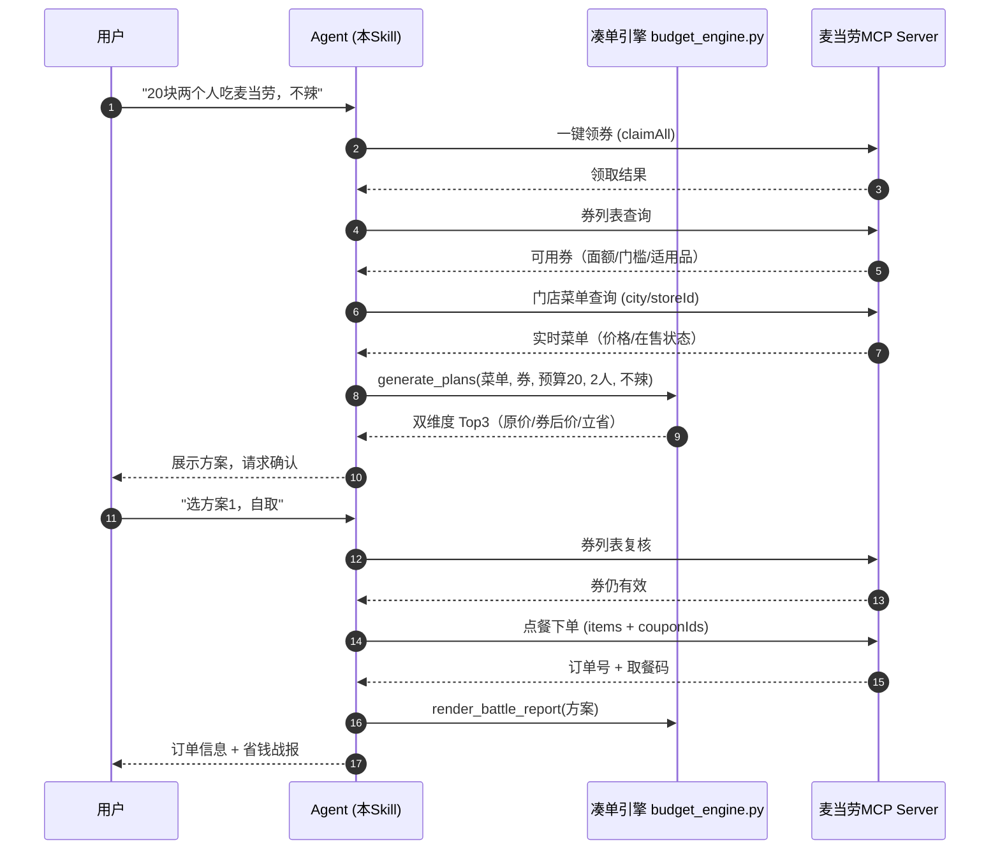

# MCP 集成说明 — 麦门穷鬼套餐生成器

## 连接配置

- **MCP Server**：麦当劳中国官方 MCP（Streamable HTTP）
- **端点**：`https://mcp.mcd.cn`
- **认证**：请求头 `Authorization: Bearer ${MCP_TOKEN}`
- **Token 管理**：仅从环境变量 `MCP_TOKEN` 读取；申请入口 https://open.mcd.cn/mcp

## 使用的 MCP 工具

| 工具（逻辑名） | 在本项目中的用途 | 调用时机 |
|---|---|---|
| 一键领券 | 对话开场自动领取全部可领优惠券，作为凑单的"弹药库" | 每次会话第 1 步 |
| 券列表查询 | 获取已持有券的面额/门槛/适用品，输入凑单引擎做券组合枚举 | 领券后、下单前（复核） |
| 门店菜单查询 | 按用户城市/门店拉取实时菜单与价格，作为背包算法的商品池 | 每次凑单前 |
| 点餐下单 | 用户确认方案后提交订单（自取 pickup / 麦乐送 delivery） | 用户明确确认后 |
| 营养查询 | （可选）用热量/蛋白质数据修正饱腹感评分，让"吃得最饱"维度更准 | 凑单前增强 |
| 活动日历 | （可选）提示近期活动，发现大额券/限时优惠时提醒用户 | 会话开场 |
| 积分兑换 | （可选）提示可用积分权益，进一步压低实付 | 方案展示时 |

> 工具名与参数一律以实际 `tools/list` 返回为准；`references/tools.md` 提供关键词模糊匹配兜底。

## 调用时序

## 异常分支

| 场景 | 处理 |
|---|---|
| 领券失败/无券 | 降级无券凑单，流程不中断 |
| 菜单为空/门店休息 | 提示换门店或时段，终止本轮 |
| 下单时券失效 | 重拉券列表 → 重跑凑单 → 重新向用户确认 |
| 下单时商品售罄 | 剔除后重凑，说明替换项 |
| 预算无解 | 返回最接近方案 + 差额，由用户决策 |

## 业务价值

1. **把"穷鬼套餐"从经验变成算法**：用户不用背券规则、不用心算凑单，一句话拿到券后最优解。
2. **提升券核销率**：开场一键领券 + 凑单时自动匹配最优券，让平台券真正被用起来。
3. **提升下单转化**：凑单 → 确认 → 下单全链路在对话内完成，无跳转流失。
4. **自传播设计**：省钱战报是可分享的社交货币，"立省 ¥XX"天然适合晒图传播。
5. **可复用技术资产**：`src/budget_engine.py` 框架无关、零依赖、带单元测试，任何 MCP Skill 可直接复用凑单能力。
