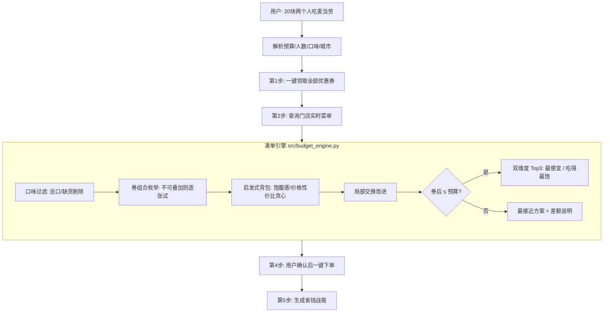

# 🍔 麦门穷鬼套餐生成器（mcd-budget-meal-skill）

> **"20 块钱，两个人，吃垮麦当劳。"**

跟 AI 说一句「20 块两个人吃麦当劳」，它自动帮你**领券 → 查菜单 → 凑单 → 下单**，
输出券后最便宜的 Top3 方案，还附赠一段可以直接发朋友圈的**省钱战报**。

穷鬼套餐不再是玄学，是算法。

`License: MIT` · `Powered by 麦当劳MCP` · `2026 麦当劳程序员创意开发大赛参赛作品`

---

## 🎬 演示

**此处放 GIF：一句"20 块两个人"→ 自动领券 → 凑出 ¥19 双人餐 → 一键下单**

```
你：20 块钱两个人吃麦当劳，不辣。
AI：已帮你领了 3 张券。凑单完成：
    方案① ¥19.00（原价 ¥36，立省 ¥17）麦香鸡×2 + 小薯条 + 中杯可乐×2
    方案② ¥20.00（原价 ¥35，立省 ¥15）麦香鸡×2 + 麦乐鸡5块
    方案③ ¥18.50（原价 ¥33，立省 ¥14.5）...
    回复"1"直接下单（自取）。
你：1
AI：下单成功！订单号 M20261009123456，凭码取餐。
    🍔 麦门穷鬼套餐战报：本单原价 ¥36.00，券后 ¥19.00，立省 ¥17.00！
```

## 🤔 这是什么

一个基于**麦当劳中国官方 MCP Server** 开发的 Skill：

- 🎫 **自动领券** — 对话一开始，把能领的券全领了，一张不落
- 📋 **实时菜单** — 按你的城市/门店拉取实时菜单和价格，拒绝云点餐
- 🧮 **凑单引擎** — 启发式背包 + 券组合枚举，券后实付严格 ≤ 预算，荤素搭配
- 🏆 **双维度 Top3** — 「最便宜」和「吃得最饱」各给 3 套方案，原价/券后价/立省一目了然
- 🛒 **一键下单** — 选好方案直接下单，自取或麦乐送
- 📣 **省钱战报** — 生成可分享的战报文案："本单原价 ¥XX，券后 ¥XX，立省 ¥XX"

预算实在不够？它会给你最接近的方案，并老实交代还差多少钱，不装。

## 🚀 快速开始

### 1. 申请 MCP Token

到 [https://open.mcd.cn/mcp](https://open.mcd.cn/mcp) 登录并申请 MCP Token。

### 2. 配置环境变量

```bash
cp .env.example .env
# 编辑 .env，填入 MCP_TOKEN=你的token
```

### 3. 安装依赖 & 跑演示

```bash
pip install -r requirements.txt
python demo.py
```

默认跑「20 元双人餐」完整流程（演示模式不真实下单）。
想真实下单：`AUTO_ORDER=1 python demo.py`（下单前脚本会展示明细）。

### 4. 在你的 Agent 里使用（WorkBuddy / 任意支持 MCP 的框架）

WorkBuddy 连接器配置（左侧边栏【专家·技能·连接器】→【连接器】→【自定义连接器】→【配置MCP】）：

```json
{
  "mcpServers": {
    "mcd-mcp": {
      "type": "streamablehttp",
      "url": "https://mcp.mcd.cn",
      "headers": {
        "Authorization": "Bearer YOUR_MCP_TOKEN"
      }
    }
  }
}
```

然后把 `SKILL.md` 交给你的 Agent，对它说："20 块两个人吃麦当劳"。

### 5. 跑单元测试

```bash
python -m pytest tests/ -v
```

## 🧠 它是怎么凑单的



核心算法在 [`src/budget_engine.py`](src/budget_engine.py)，纯 Python 零依赖、带单元测试，
可以单独抠出来用在任何项目里。

## 👥 目标用户

- 月底吃土但想吃麦当劳的**大学生 / 打工人**
- 想把每分钱花出响的**穷鬼套餐原教旨主义者**
- 想用真实 MCP 能力做参考的**MCP Skill 开发者**（凑单引擎可直接复用）

## ❓ FAQ

**Q：20 块真的够两个人吃吗？**
A：看城市、看券、看命。引擎会尽力；实在不够，它会告诉你最接近的方案差多少钱，绝不硬凑出空气套餐。

**Q：券能叠加吗？**
A：一般不能。引擎会把每张券单独试一遍（枚举所有券组合），取券后最省的那个方案。

**Q：会拿我的 Token 干坏事吗？**
A：Token 只读环境变量 `MCP_TOKEN`，代码里没有任何硬编码，`.env` 已在 `.gitignore` 排除。欢迎审查，一共没几行代码。

**Q：不吃辣 / 素食能吃吗？**
A：能。对话里说"不辣"或"素食"即可，引擎会先过滤再凑单。

**Q：下单能取消吗？**
A：下单前会展示完整明细等你确认；真实下单后请走麦当劳官方渠道处理售后。

**Q：这是麦当劳官方产品吗？**
A：不是。这是 2026 麦当劳程序员创意开发大赛参赛作品，基于官方 MCP 开发的第三方项目。餐品信息、价格以麦当劳官方渠道实时结果为准。

## ⭐ 求 Star

如果这个工具帮你省过一顿饭钱，或者你就是喜欢看 AI 为了 20 块钱绞尽脑汁——

**点个 Star 吧！** 本项目正在参加 **2026 麦当劳程序员创意开发大赛**，排名完全看 Star 数。

你的一颗 ⭐，就是穷鬼的一顿饭。让"20 块吃垮麦当劳"冲上排行榜第一，
我们一起去麦当劳门口还愿。🙏🍟

## 📄 许可与声明

- 代码以 [MIT License](LICENSE) 开源
- 参赛声明见 [CONTEST_DECLARATION.md](CONTEST_DECLARATION.md)
- MCP 集成说明见 [MCP_INTEGRATION.md](MCP_INTEGRATION.md)
- 本项目为第三方参赛作品，非麦当劳官方产品；价格与供应以官方实时数据为准
